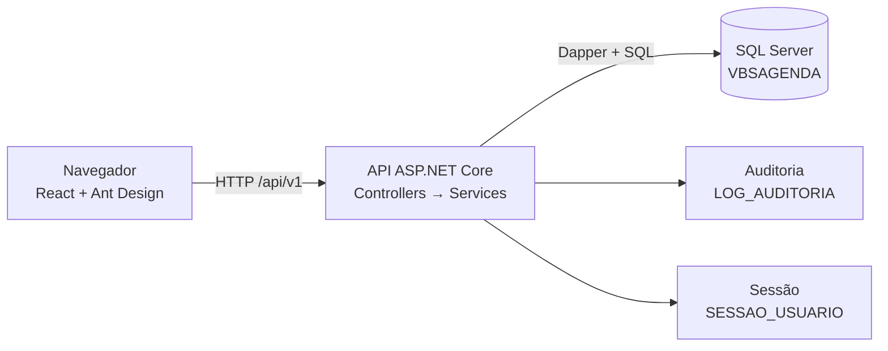

# Arquitetura – VBS Agendamento

Este documento descreve como o sistema é organizado e como acrescentar novas funcionalidades.

## 1. Visão geral

- A tela fala só com a API, por `/api/v1`. Em desenvolvimento, o Vite (porta 5173) repassa `/api` para a API (porta 5000).
- A API é um único projeto, organizado em pastas por funcionalidade.
- O banco concentra as regras de integridade (chaves, unicidade, `CHECK`, gatilhos). A API valida antes para devolver mensagens claras,
  mas o banco é a última barreira.
- O contrato `openapi.yaml` é a fonte da verdade das rotas, dos campos e das liberações (`x-permissao`).

## 2. Servidor (`src/VBS.Agendamento.Api`)

### 2.1 Pastas

| Pasta | Conteúdo |
|---|---|
| `Program.cs` | Configuração, autenticação, limite de requisições, CORS e registro dos serviços |
| `Common/` | `Erro` (erros no formato do contrato), `ErroCampo`, `CpfUtil`, `CnpjUtil`, `Formatos` (e-mail, telefone, UF, senha), `DataBrasil` |
| `Infra/Db/` | `ConexaoFactory` (abre conexões, `Sql.Cmd`, `Sql.Char`) e `Auditoria` |
| `Infra/Seguranca/` | `SessaoAuthHandler`, `PermissaoService`, atributo `[Permissao]`, `HashSenha`, `UsuarioAtual` |
| `Infra/Inicializacao/` | `CatalogoTelas` e `Inicializador` (grava o catálogo de telas e cria o administrador inicial) |
| `Features/<Nome>/` | Uma pasta por funcionalidade: `Controller`, `Service` e `Dtos` |
| `contrato/openapi.yaml` | Contrato da API |

### 2.2 Funcionalidades (Features)

Auth, Apoio, Pacientes (inclui responsável legal), Profissionais, Unidades, Salas, Colaboradores, Especialidades,
Convênios, Formas de pagamento, Perfis e Usuários.

### 2.3 Padrão de uma funcionalidade

- **Controller:** define a rota (`api/v1/...`), a liberação (`[Permissao("tela.cadastro:acao")]`) e chama o serviço. Não tem regra de negócio.
- **Service:** valida os dados, aplica as regras, grava com transação e registra a auditoria.
- **Dtos:** classes de entrada (campos anuláveis, para validar com mensagem própria) e de saída.
- Leitura em duas etapas: a consulta devolve uma classe interna (`Linha`) e o serviço converte para o DTO.

### 2.4 Acesso a dados

- **Dapper** com SQL escrito à mão. Motivo: o banco usa gatilhos, restrições compostas e, no futuro, Always Encrypted.
- Toda operação que grava abre uma **transação** (`BeginTransactionAsync`) e só confirma no fim, incluindo a auditoria.
- Colunas `CHAR(n)` (CPF, CNPJ, CEP, UF) usam `Sql.Char(valor, n)` para o tipo certo no parâmetro.
- Duplicidade: o serviço confere antes (COUNT) e também trata o erro do banco (2601/2627) pelo nome do índice, para o caso de duas gravações simultâneas.
- Datas: o banco guarda em UTC (`SYSUTCDATETIME()`); datas de regra de negócio valem no horário de Brasília (`DataBrasil`).

### 2.5 Erros

Todos os erros saem em `application/problem+json`, com `codigo` e, quando for o caso, a lista `erros[]` (`campo` e `mensagem`).

| Método | Status | Quando |
|---|---|---|
| `Erro.Validacao` | 400 | Campo inválido ou vazio |
| `Erro.Regra` | 400 | Regra de negócio, com `codigo` próprio |
| `Erro.Conflito` | 409 | Duplicidade ou bloqueio (ex.: `CPF_DUPLICADO`, `NUMERO_SALA_DUPLICADO`, `UNIDADE_COM_CONSULTAS`) |
| `Erro.NaoEncontrado` | 404 | Registro inexistente |
| `Erro.SemPermissao` | 403 | Sem liberação |
| `Erro.NaoAutenticado` | 401 | Sessão ausente, expirada ou login inválido |

A tela lê `codigo` e `erros[]` para mostrar a mensagem no campo certo.

### 2.6 Segurança

- **Sessão opaca no servidor:** token aleatório; só o hash fica em `SESSAO_USUARIO`. Expira após 30 minutos de inatividade, encerra no logout, no bloqueio e na troca de senha.
- **Senha:** PBKDF2-SHA256, 210 mil iterações, sal por senha. Mínimo de 10 caracteres com letras, números e caractere especial.
- **Bloqueio:** 5 senhas erradas bloqueiam o usuário.
- **Limite de requisições** nas rotas públicas (10 por minuto).
- **Liberações (RNF08):** cada ação confere `tela:acao` do perfil. O perfil Administrador é protegido e tem acesso total.
  Um perfil com várias liberações no atributo `[Permissao]` passa se tiver qualquer uma.
- **Auditoria:** `LOG_AUDITORIA` registra LOGIN, LOGIN_FALHA, VISUALIZAR, INCLUIR, EDITAR, EXCLUIR, EXPORTAR e CORRECAO_PRONTUARIO,
  com entidade, identificador, usuário e, na edição, **apenas os nomes dos campos alterados** (nunca os valores).
- **LGPD:** consentimentos do paciente e do responsável legal ficam em tabelas somente de inclusão (cada mudança é uma linha nova, sem UPDATE/DELETE).

## 3. Banco de dados (`banco/`)

- Scripts numerados e idempotentes (podem rodar mais de uma vez): `01` cria as tabelas; `02` restrições, índices e objetos; `03` views de análise;
  `04` a `11` ajustes de login, sessão, status, prontuário, credenciamento, notificações e índices; `12` a `18` evoluções feitas durante as fatias
  (número e complemento de endereço, campos opcionais do paciente, responsável legal, identificação da sala, dados CLT).
- Regras fortes no banco: unicidade de CPF e CNPJ por tabela, `CHECK` de vínculo (CLT exige CPF; MEI exige CNPJ e razão social),
  chave composta Sala × Unidade usada pela consulta (RN11), gatilhos somente-inclusão para consentimentos.
- Nomes em MAIÚSCULAS; chave primária `CODIGO_<ENTIDADE>`; datas de criação e atualização com usuário responsável.
- A **matrícula** do colaborador/prestador é o `CODIGO_CLB_PRT` (identity). A tela e a API não permitem alterá-la; só UPDATE direto no banco.

## 4. Tela (`web`)

### 4.1 Pastas

| Pasta | Conteúdo |
|---|---|
| `src/main.tsx` | Ponto de entrada (tema, idioma pt-BR, rotas, sessão) |
| `src/App.tsx` | Rotas; cada rota protegida por `RotaProtegida tela="x.cadastro"` |
| `src/api/cliente.ts` | `api.get/post/put/patch/delete`, base `/api/v1`, token da sessão, `ApiErro` (status, codigo, erros, extras) |
| `src/api/tipos.ts` | Tipos compartilhados (Unidade, Sala, Paciente, ItemApoio…) |
| `src/auth/` | `AuthContext` (`useAuth().pode(tela, acao)`) e `RotaProtegida` |
| `src/layout/LayoutPrincipal.tsx` | Menu lateral (`ITENS`) e cabeçalho |
| `src/paginas/<nome>/` | Uma pasta por tela |
| `src/componentes/` | Componentes reutilizáveis (ex.: `CampoNumeroEndereco`) |
| `src/util/formatos.ts` | Máscaras e validações (CPF, CNPJ, CEP, celular, datas) |
| `src/tema.ts`, `src/estilos.css` | Cores da marca e estilos globais |

### 4.2 Padrão de uma tela de cadastro

- Tabela com paginação feita no servidor (10 por página), busca, filtros e botões de ação conforme a liberação do perfil.
- Formulário em janela (`Modal`) com `destroyOnClose` e `preserve={false}`; campos com máscara via `normalize`.
- Campo obrigatório vazio: **"Campo Não Preenchido"**. Erros do servidor vão para o campo certo (`form.setFields`).
- Ativar/inativar com `modal.confirm`; bloqueios (ex.: `SALA_COM_CONSULTAS`) viram aviso com a quantidade.
- A sessão fica na aba do navegador (`sessionStorage`).

## 5. Regras de negócio (índice)

| Código | Resumo |
|---|---|
| RN11 | Consulta só usa sala da mesma unidade (chave composta) |
| RN13 | CPF e CNPJ válidos e únicos |
| RN14 | Inativar em vez de excluir; reativar sempre permitido |
| F4 | Não inativa unidade ou sala com consulta futura marcada ou em andamento (409 com a quantidade) |
| LGPD | Menor de idade exige responsável legal e consentimento dele; consentimentos são históricos |
| Matrícula | `CODIGO_CLB_PRT`, automática e somente leitura |

O detalhamento completo está no documento do projeto (fora deste repositório ou na pasta `docs`, se você o incluir).

## 6. Como acrescentar uma funcionalidade

1. **Banco:** crie o script numerado em `banco/` (MAIÚSCULAS, idempotente) e rode no SSMS.
2. **Contrato:** confira as rotas, os campos e o `x-permissao` em `contrato/openapi.yaml`; atualize se algo mudar.
3. **Servidor:** crie `Features/<Nome>/` com `Dtos`, `Service` e `Controller` (use `Features/Salas` como modelo simples);
   registre o serviço em `Program.cs` com `AddScoped`.
4. **Catálogo de telas:** se for uma tela nova, confira o código em `Infra/Inicializacao/CatalogoTelas.cs`.
5. **Tela:** crie `web/src/paginas/<nome>/<Nome>Pagina.tsx` (modelo: `salas/SalasPagina.tsx`), os tipos em `tipos.ts`,
   a rota em `App.tsx` e o item em `ITENS` no `LayoutPrincipal.tsx`.
6. **Liberação:** no perfil, marque a tela e as ações; o Administrador já tem tudo.
7. **Teste:** reinicie o `dotnet run`, recarregue a tela (Ctrl+F5) e percorra o roteiro (criar, duplicar, editar, inativar, filtros, perfil sem liberação).

## 7. Decisões de arquitetura

| Decisão | Motivo |
|---|---|
| Projeto único com pastas por funcionalidade | Simples para o tamanho atual; dá para separar em camadas depois |
| Dapper em vez de Entity Framework | O banco já tem gatilhos, restrições compostas e criptografia planejada |
| Sessão opaca em vez de JWT | Exige expiração por inatividade, logout imediato e encerramento ao bloquear ou trocar a senha |
| Contrato OpenAPI primeiro | Servidor e tela seguem a mesma especificação |
| Auditoria só com nomes de campos | Evita copiar dados pessoais para o log |
| Conta do Windows no banco (desenvolvimento) | Não cria logins novos no SQL Server; em produção usar conta própria na `ROLE_APP_AGENDAMENTO` |

## 8. Limitações atuais

- Liberação por campo (E2/RN24) ainda não existe; vale a liberação por tela e ação.
- Recuperação de senha com e-mail simulado.
- Sem testes automáticos.
- Always Encrypted (prontuário) e retenção de logs (RNF04) ainda não implementados.
- Ambiente local, sem HTTPS, sem dados reais.
